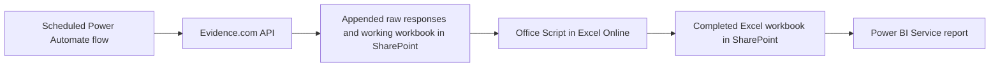

# BWC Uncategorized Reporting MVP

Automate the documented Evidence.com uncategorized-report process using **Power Automate cloud flows, Excel Online, SharePoint, and Power BI Service**. The scheduled run does not use a desktop, R, or a Python server.



Start with the [step-by-step implementation guide](docs/implementation-guide.md) ([printable PDF](docs/implementation-guide.pdf)): cloning, SharePoint, scripts, credentials, flow actions, report publication, and daily/weekly operation.

The [cloud setup guide](docs/microsoft-365-setup.md) covers the flow actions, workbook template, report tables, and refresh sequence. The [Axon integration guide](docs/axon-api-integration.md) maps the supplied vendor documentation into token acquisition, reporting pagination, and field normalization. The [reporting rules](docs/reporting-rules.md) record the decisions and source assumptions. The agency bindings are saved privately and the recording-creation start is March 11, 2024. Secure connections, Reports.read confirmation, SharePoint destination, and Power BI workspace remain needed for live deployment.

Included files:

- [Office Script](automation/ProcessEvidence.office.ts), run by Power Automate in Excel Online.
- [Blank workbook template](automation/report-template.xlsx) for backfill, plus [ReadRefreshState](automation/ReadRefreshState.office.ts) to read the previous watermark from an incremental working copy.
- [Power Query files](powerbi/) and [DAX measures](powerbi/measures.dax) for report authoring.
- [Editable Power BI project template](powerbi/template/README.md), with Overview, Remediation, and Data Quality pages, embedded synthetic data, and SharePoint parameters. Open the .pbip in Desktop and save as .pbix when needed.
- [Axon response schema and flow expression fragments](automation/), plus incomplete-page protection in the Office Script.
- A Python reference converter and entirely synthetic source data for local verification.

Critical starts at **30 calendar days since upload**; moderate is **15–29**; normal is **0–14**. This measures upload age, not the separate three-business-day policy mentioned in the process notes. Active and queued-for-deletion evidence is eligible; categorized items are excluded.

To inspect a demo without connecting any accounts:

```bash
python3 -m pip install -r requirements.txt
python3 -m bwc_report --input examples/evidence.sample.csv \
  --as-of 2026-10-13 --source-date 2026-10-13 --sample --xlsx --output output/demo
```

The command creates six CSV files, a seven-sheet Excel workbook, and a manifest in an immutable run folder. `output/demo/latest/manifest.json` identifies that completed run. The sample has **8 uncategorized items: 2 normal, 2 moderate, 4 critical**, and **3 rejected source records**. None of its names or evidence identifiers represents a real person or recording.

To verify the documented API format using synthetic paginated responses:

```bash
python3 -m bwc_report --input examples/axon-pages.sample.json --input-format axon-page-bundle \
  --as-of 2026-10-13 --sample --xlsx --output output/api-demo
```

The production flow requests both `EvidenceCreated` and `EvidenceUpdated` with `pageSize=50`, increments `pageOffset` by 1, and includes each final empty page before invoking the script in `axon-refresh-bundle` mode. The reference command above verifies a complete Created-only snapshot. Creation dates define the population; upload age is calculated separately. The workbook records the source window and successful UTC watermark. No authenticated Axon report request has been made from this task.

To convert an actual CSV for testing, supply its path and the appropriate snapshot date. `--column-map` accepts a JSON mapping from the documented column names to actual export names. `--fail-on-rejects` prevents publication when required fields are invalid. The Python tool is a reference/verification utility; the production cloud route uses the Office Script.

```bash
python3 -m unittest discover -s tests -v
```

Optional syntax/parity tooling uses Node 22+ with `typescript@5.9.3` and `@microsoft/powerquery-parser@2.0.0`; see the setup guide. Local Office Script tests use a workbook test double and do not establish that a tenant's Excel Online or Power BI connections work.

The API setup now supports an initial backfill from **March 11, 2024** and daily or weekly incremental runs. Each run appends raw history to SharePoint and updates an Excel EvidenceState ledger by internal ID. Category/status changes remove resolved items from the current backlog; unchanged records still age on each refresh. See [the API integration guide](docs/axon-api-integration.md) for the two endpoint formats, watermark rules, and periodic full reconciliation. Live API/tenant connections and SharePoint/Power BI destinations remain to be configured.
