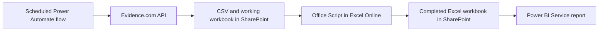

# BWC Uncategorized Reporting MVP

Automate the documented Evidence.com uncategorized-report process using **Power Automate cloud flows, Excel Online, SharePoint, and Power BI Service**. The scheduled run does not use a desktop, R, or a Python server.



The [cloud setup guide](docs/microsoft-365-setup.md) covers the flow actions, workbook template, report tables, and refresh sequence. The [reporting rules](docs/reporting-rules.md) record the decisions and source assumptions. API endpoint/authentication documentation, the actual export schema, SharePoint destination, and Power BI workspace are still needed to connect and deploy the live process.

Included files:

- [Office Script](automation/ProcessEvidence.office.ts), run by Power Automate in Excel Online.
- [Blank workbook template](automation/report-template.xlsx), copied into a working folder for each run.
- [Power Query files](powerbi/) and [DAX measures](powerbi/measures.dax) for report authoring.
- A Python reference converter and entirely synthetic source data for local verification.

Critical starts at **30 calendar days since upload**; moderate is **15–29**; normal is **0–14**. This measures upload age, not the separate three-business-day policy mentioned in the process notes. Active and queued-for-deletion evidence is eligible; categorized items are excluded.

To inspect a demo without connecting any accounts:

```bash
python3 -m pip install -r requirements.txt
python3 -m bwc_report --input examples/evidence.sample.csv \
  --as-of 2026-10-13 --source-date 2026-10-13 --sample --xlsx --output output/demo
```

The command creates six CSV files, a seven-sheet Excel workbook, and a manifest in an immutable run folder. `output/demo/latest/manifest.json` identifies that completed run. The sample has **8 uncategorized items: 2 normal, 2 moderate, 4 critical**, and **3 rejected source records**. None of its names or evidence identifiers represents a real person or recording.

To convert an actual CSV for testing, supply its path and the appropriate snapshot date. `--column-map` accepts a JSON mapping from the documented column names to actual export names. `--fail-on-rejects` prevents publication when required fields are invalid. The Python tool is a reference/verification utility; the production cloud route uses the Office Script.

```bash
python3 -m unittest discover -s tests -v
```

Optional syntax/parity tooling uses Node 22+ with `typescript@5.9.3` and `@microsoft/powerquery-parser@2.0.0`; see the setup guide. Local Office Script tests use a workbook test double and do not establish that a tenant's Excel Online or Power BI connections work.
